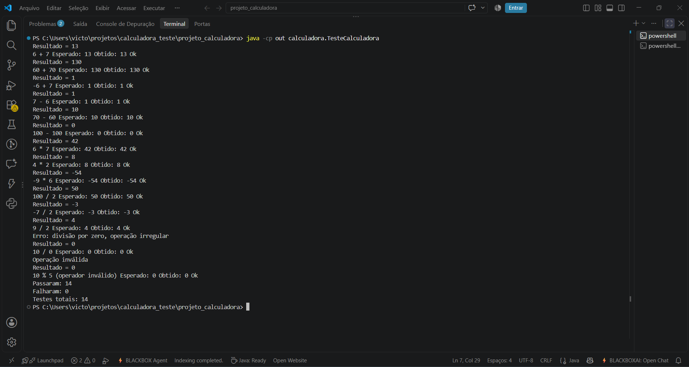
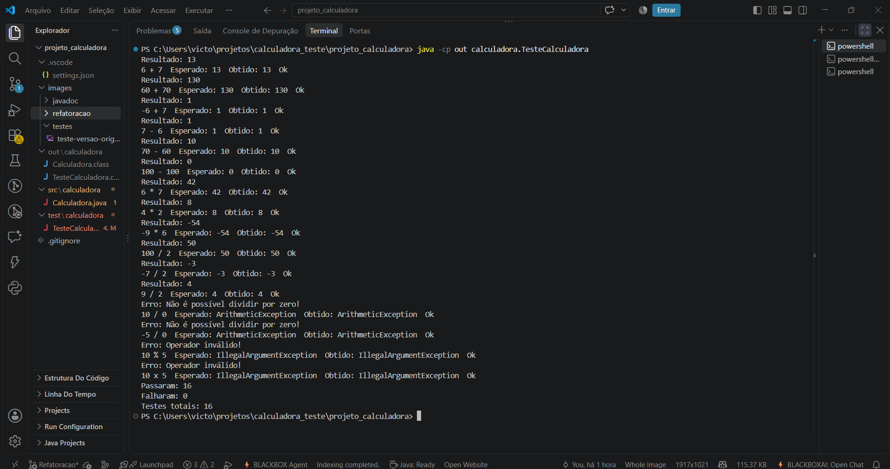
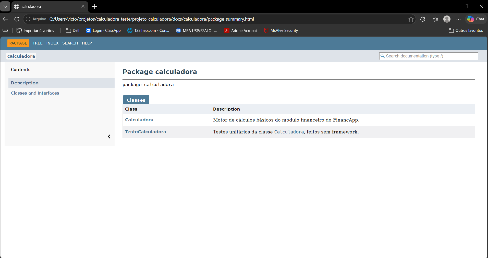
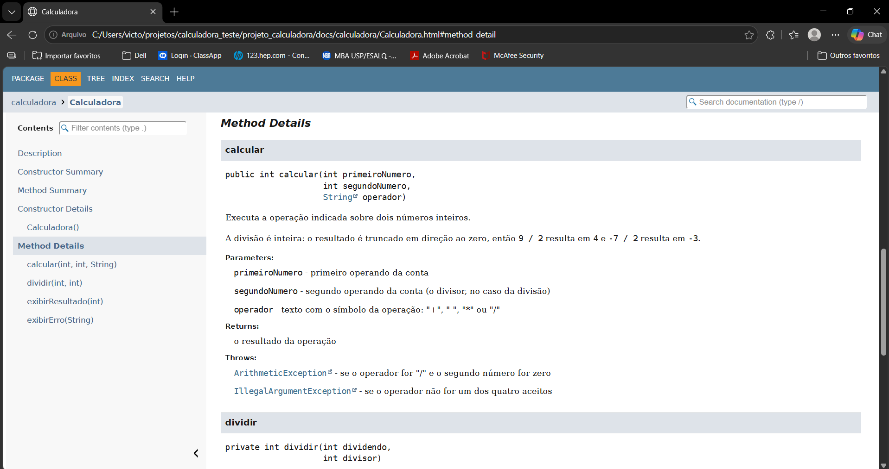

# Projeto Calculadora — FinançApp

> Projeto acadêmico desenvolvido com foco em Qualidade de Software, Testes, Refatoração, Documentação e Versionamento.

---

## 1. Identificação do Projeto

**Projeto:** Projeto Calculadora  
**Contexto:** FinançApp  
**Aluno:** Victor Akimoto Ferreira  
**RA:** 264396  
**Curso:** Tecnologia em Análise e Desenvolvimento de Sistemas  
**Disciplina:** UX/UI e Testes de Software  
**Professor:** Daniel Ohata  
**Semestre:** 2026.2  
**Repositório:** https://github.com/victorakimoto/projeto_calculadora

---

## 2. Visão Geral

Este projeto é um módulo de cálculos matemáticos básicos em Java, criado para a startup **FinançApp**, um aplicativo de controle de finanças pessoais.

O módulo foi pensado para ser reaproveitado em funcionalidades como:

- orçamento mensal;
- divisão de despesas;
- projeção de economia;
- cálculos auxiliares do sistema.

Além de calcular corretamente, o projeto passou por testes, tratamento de erros, refatoração, documentação com JavaDoc e versionamento com Git e GitHub.

---

## 3. Problema

A equipe do FinançApp precisava de um módulo de cálculo que fosse confiável e fácil de manter. Não bastava funcionar: o código precisava ser legível, testado, documentado e seguro contra entradas inválidas, como a divisão por zero.

---

## 4. Objetivo

### 4.1 Objetivo Geral

Desenvolver uma calculadora em Java aplicando práticas de qualidade de software: testes, tratamento de erros, refatoração, documentação e versionamento.

### 4.2 Objetivos Técnicos

- implementar soma, subtração, multiplicação e divisão;
- impedir a divisão por zero;
- tratar operadores inválidos;
- criar testes que mostrem entrada, resultado esperado e resultado obtido;
- refatorar o código sem piorar o funcionamento;
- documentar classes, métodos e atributos com JavaDoc;
- gerar a documentação em HTML;
- organizar commits e branches no GitHub.

---

## 5. Escopo Funcional

| ID   | Funcionalidade       | Descrição                                      | Status |
| ---- | -------------------- | ---------------------------------------------- | ------ |
| RF01 | Soma                 | Soma dois números inteiros                     | ✅      |
| RF02 | Subtração            | Subtrai dois números inteiros                  | ✅      |
| RF03 | Multiplicação        | Multiplica dois números inteiros               | ✅      |
| RF04 | Divisão              | Divide dois números inteiros (divisão inteira) | ✅      |
| RF05 | Validação de divisão | Impede divisão por zero                        | ✅      |
| RF06 | Operação inválida    | Trata operadores não suportados                | ✅      |

---

## 6. Requisitos Não Funcionais

| ID    | Categoria      | Requisito                                           | Como foi atendido                                            |
| ----- | -------------- | --------------------------------------------------- | ------------------------------------------------------------ |
| RNF01 | Qualidade      | Código organizado e legível                         | Nomes descritivos, métodos curtos e indentação padronizada   |
| RNF02 | Testabilidade  | Operações com testes automatizados                  | Classe `TesteCalculadora` com 16 casos                       |
| RNF03 | Manutenção     | Refatoração sem alteração funcional                 | Branch `Refatoracao`, com os testes executados novamente     |
| RNF04 | Documentação   | Classes e métodos com JavaDoc                       | JavaDoc nas duas classes, gerado na pasta `docs/`            |
| RNF05 | Versionamento  | Uso de Git e GitHub                                 | Commits pequenos e duas branches                             |
| RNF06 | Confiabilidade | Erros não interrompem a execução de forma inesperada | Erros viram exceções com mensagem clara, capturadas nos testes |

---

## 7. Tecnologias Utilizadas

| Tecnologia | Versão                    | Utilização                                   |
| ---------- | ------------------------- | -------------------------------------------- |
| Java       | 25.0.4.1 (LTS, Temurin)   | Desenvolvimento                              |
| JDK        | 25.0.4.1                  | Compilação                                   |
| JUnit      | Não utilizado             | Os testes foram escritos em Java puro, com `main` |
| Git        | 2.55.0.windows.3          | Controle de versão                           |
| GitHub     | —                         | Repositório remoto                           |
| JavaDoc    | Incluído no JDK 25.0.4.1  | Documentação                                 |
| IDE        | VS Code 1.144.0           | Ambiente de desenvolvimento                  |

---

## 8. Estrutura do Projeto

```
projeto_calculadora/
│
├── src/
│   └── calculadora/
│       └── Calculadora.java
│
├── test/
│   └── calculadora/
│       └── TesteCalculadora.java
│
├── docs/
│   └── index.html
│
├── images/
│   ├── testes/
│   ├── javadoc/
│   └── refatoracao/
│
├── README.md
└── .gitignore
```

A pasta `out/`, com os arquivos compilados, não vai para o repositório (está no `.gitignore`).

---

## 9. Explicação das Operações

O método principal é `calcular(int primeiroNumero, int segundoNumero, String operador)`. Ele recebe dois inteiros e um texto com o operador, e devolve um `int`.

| Operador | Operação      | Exemplo      | Resultado |
| -------- | ------------- | ------------ | --------- |
| `+`      | Soma          | `6 + 7`      | `13`      |
| `-`      | Subtração     | `7 - 6`      | `1`       |
| `*`      | Multiplicação | `-9 * 6`     | `-54`     |
| `/`      | Divisão inteira | `9 / 2`    | `4`       |

**Observação sobre a divisão:** como os números são `int`, o resultado é truncado em direção ao zero. Por isso `9 / 2` dá `4` e `-7 / 2` dá `-3`.

**Tratamento de erros:**

| Situação            | Exemplo  | Resposta do sistema                                |
| ------------------- | -------- | -------------------------------------------------- |
| Divisão por zero    | `10 / 0` | Lança `ArithmeticException` com mensagem explicativa |
| Operador inválido   | `10 % 5` | Lança `IllegalArgumentException` com mensagem explicativa |

Além do `calcular`, a classe tem os métodos `exibirResultado` e `exibirErro`, que mostram os resultados e as mensagens no console.

---

## 10. Testes

Os testes foram escritos na classe `TesteCalculadora`, sem framework. Para cada caso o programa imprime a **entrada**, o **resultado esperado**, o **resultado obtido** e se o teste passou (`Ok`) ou falhou (`Falhou`). No final, mostra o resumo.

### 10.1 Casos de teste (16)

| Grupo               | Entrada     | Esperado               |
| ------------------- | ----------- | ---------------------- |
| Soma                | `6 + 7`     | `13`                   |
| Soma                | `60 + 70`   | `130`                  |
| Soma                | `-6 + 7`    | `1`                    |
| Subtração           | `7 - 6`     | `1`                    |
| Subtração           | `70 - 60`   | `10`                   |
| Subtração           | `100 - 100` | `0`                    |
| Multiplicação       | `6 * 7`     | `42`                   |
| Multiplicação       | `4 * 2`     | `8`                    |
| Multiplicação       | `-9 * 6`    | `-54`                  |
| Divisão             | `100 / 2`   | `50`                   |
| Divisão             | `-7 / 2`    | `-3`                   |
| Divisão             | `9 / 2`     | `4`                    |
| Divisão por zero    | `10 / 0`    | `ArithmeticException`  |
| Divisão por zero    | `-5 / 0`    | `ArithmeticException`  |
| Operador inválido   | `10 % 5`    | `IllegalArgumentException` |
| Operador inválido   | `10 x 5`    | `IllegalArgumentException` |

### 10.2 Execução na versão original (branch principal, antes da refatoração)

Resultado: 14 testes executados, 14 aprovados. Nessa versão, os erros eram tratados com uma mensagem e retorno `0`.



### 10.3 Execução na versão refatorada (branch `Refatoracao`)

Resultado: 16 testes executados, 16 aprovados (`Passaram: 16`, `Falharam: 0`).



---

## 11. Refatoração

A refatoração foi feita na branch `Refatoracao`, com os testes executados novamente no final.

### 11.1 O que mudou

| Antes                                            | Depois                                                   | Técnica                          |
| ------------------------------------------------ | -------------------------------------------------------- | -------------------------------- |
| Método `calc`                                    | Método `calcular`                                        | Renomear método                  |
| Parâmetros `a`, `b`, `op`                        | `primeiroNumero`, `segundoNumero`, `operador`            | Melhorar nomes de variáveis      |
| Atributo `public int r`                          | Removido; cada `case` devolve o resultado direto         | Eliminar estado desnecessário    |
| Cadeia de `if / else if`                         | Estrutura `switch`                                       | Simplificar condicionais         |
| Divisão e checagem do zero dentro do `if`        | Método privado `dividir`                                 | Extração de método               |
| `System.out.println` dentro do `calc`            | Métodos `exibirResultado` e `exibirErro`                 | Separar cálculo e exibição       |
| Mensagem impressa e retorno `0` nos erros        | Exceções com mensagem                                    | Melhorar o tratamento de erros   |

### 11.2 Mudança de comportamento nos erros

Na versão original, divisão por zero e operador inválido imprimiam uma mensagem e retornavam `0`. Esse `0` podia ser confundido com um resultado válido (como em `100 - 100`). Na versão refatorada esses casos lançam exceção com mensagem clara, e o teste verifica o **tipo** da exceção lançada. Os resultados das quatro operações continuam os mesmos.

### 11.3 Código resultante

```java
public int calcular(int primeiroNumero, int segundoNumero, String operador) {
    switch (operador) {
        case "+":
            return primeiroNumero + segundoNumero;
        case "-":
            return primeiroNumero - segundoNumero;
        case "*":
            return primeiroNumero * segundoNumero;
        case "/":
            return dividir(primeiroNumero, segundoNumero);
        default:
            throw new IllegalArgumentException("Operador inválido!");
    }
}
```

---

## 12. Documentação (JavaDoc)

As duas classes foram documentadas com `@author`, `@version`, `@param`, `@return` e `@throws`, além de comentários técnicos no código. A documentação em HTML foi gerada na pasta `docs/`; para abri-la, use o arquivo `docs/index.html` no navegador.





---

## 13. Como Executar

Na raiz do projeto, em um terminal:

```
javac -encoding UTF-8 -d out src\calculadora\*.java test\calculadora\*.java
java -cp out calculadora.TesteCalculadora
```

Para gerar o JavaDoc novamente:

```
javadoc -private -encoding UTF-8 -docencoding UTF-8 -charset UTF-8 -d docs src\calculadora\*.java test\calculadora\*.java
```

---

## 14. Versionamento

| Branch        | Conteúdo                                                                  |
| ------------- | ------------------------------------------------------------------------- |
| `main`        | Versão final, após o merge da Refatoracao. A versão original está registrada no commit 720a85a |
| `Refatoracao` | Código refatorado, testes atualizados, JavaDoc e README                   |

Histórico de commits:

```
2fade65 Registra capturas da documentacao gerada
b3d334f Gera documentacao HTML com o JavaDoc
240146a Adiciona JavaDoc nos atributos passaram e falharam e nos metodos de teste
ce8b752 Documenta Calculadora com JavaDoc e comentarios sobre o switch e o dividir
67139a9 Corrige extensao do print da refatoracao
950919f Adiciona print dos 16 testes passando na versao refatorada
612a4e0 Atualiza TesteCalculadora para calcular e verifica excecoes por tipo
84442bc Troquei calc por calcular, tirei o atributo r, passou a lançar exceções e extraiu o dividir
720a85a Print dos testes
0118d7e Adiciona os testes
b543588 Cria calculadora
9613d7a Adiciona gitignore
```

---

## 15. Dificuldades e Aprendizados
~~~~
Ao compilar, o comando foi dividido em duas linhas ao colar no terminal, e só a Calculadora foi recompilada. 
O Java executou um TesteCalculadora.class antigo e deu NoSuchMethodError.
Aprendi que um .class desatualizado pode enganar e que é melhor recompilar tudo em um comando só.

Na versão original, divisão por zero e operador inválido retornavam 0, que se confundia com um resultado válido, como em 100 - 100.
Troquei por exceções, e o teste precisou capturar o tipo certo (ArithmeticException e IllegalArgumentException).
Também mantive o parâmetro operador como String, porque trocar por char mudaria o contrato do método.

Ao salvar os prints, o Windows criou uma pasta em vez de um arquivo, e um arquivo ficou sem .png, o que quebraria a imagem no GitHub.
Aprendi a conferir com dir (o Mode -a---- indica arquivo) e a verificar o nome exato antes de referenciar no README.

~~~~
---

## 16. Link do Repositório

https://github.com/victorakimoto/projeto_calculadora
